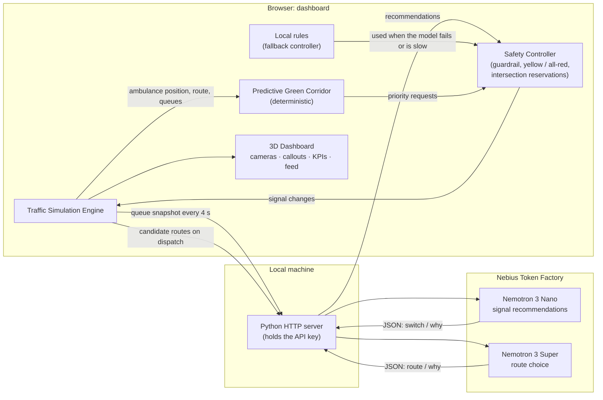
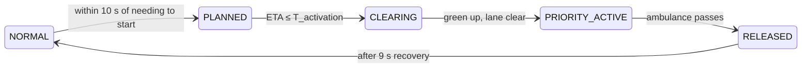

# UrbanFlow AI

### Intelligent Urban Traffic Orchestration Powered by Physical AI

**Nebius x NVIDIA Global AI Hackathon 2026 · Physical AI track**

UrbanFlow AI is a traffic-signal control system for a simulated city. NVIDIA Nemotron models, served by Nebius Token Factory, recommend ordinary signal changes and help plan ambulance routes. A deterministic **Predictive Green Corridor** predicts when an ambulance will reach each intersection on its route and turns those lights green early enough for waiting cars to clear before it arrives. A safety controller decides what actually reaches the signals, so a model reply can never create an unsafe light.

Everything runs in a custom traffic simulation shown as an interactive 3D night-city dashboard. Results in this repository come from that simulation. They are not real-world measurements.

---

## Contents

- [Problem and pitch](#problem-and-pitch)
- [Core capabilities](#core-capabilities)
- [System architecture and components](#system-architecture-and-components)
- [NVIDIA and Nebius integration](#nvidia-and-nebius-integration)
- [Predictive Green Corridor](#predictive-green-corridor)
- [Technology stack](#technology-stack)
- [Installation and setup](#installation-and-setup)
- [Hackathon demonstration](#hackathon-demonstration-cross-town-emergency)
- [Testing and results](#testing-and-results)
- [Future development](#future-development)
- [Links](#links)

---

## Problem and pitch

Most traffic signals still run on fixed timers or simple detector loops. They hold a red light against an empty cross street, let queues build on busy roads, and know nothing about an ambulance until it is at the stop line. An ambulance stuck behind a queue at a red light has two bad options: wait, or cross against the light while cars try to get out of its way.

**UrbanFlow AI treats the signal network as one coordinated system.** Ordinary signals adapt to the queues they can see. When an ambulance is dispatched, the system knows its route and destination, predicts its arrival at each upcoming intersection, works out how long each queue needs to drain, and turns each light green at that moment. Lights further along the route keep running normally until they are needed.

---

## Core capabilities

| Capability | What it does | Status |
| --- | --- | --- |
| **Adaptive traffic signal optimization** | Nemotron 3 Nano reviews the intersections whose green could end and recommends which to switch, with a reason. A deterministic idle-green safeguard ends greens nobody is using. Local rules can do the same job without a model. | Implemented |
| **Emergency ambulance routing** | Nemotron 3 Super chooses between up to three candidate routes per dispatch when AI control is on with Nemotron selected as the controller. During the trip, a deterministic planner can reroute around stopped traffic. | Implemented |
| **Predictive Green Corridor** | Per-intersection lead time from signal state, queue discharge and an uncertainty margin; intersections are prepared one after another rather than all at once. | Implemented and benchmarked in simulation |
| **Traffic simulation and safety controls** | Multi-lane roads, lane changes, turns, intersection reservations, yielding to ambulances, cautious red-light crossing, yellow and all-red clearance, a guardrail on model output, and fallback to local rules. | Implemented and tested in simulation |
| **Interactive 3D urban dashboard** | Night-city view with Omniscient, Chase and Intersection cameras, map callouts, live KPIs, a decision feed and an Intersections Ahead list. | Implemented |
| **Conventional vs. AI-assisted comparison** | The Cross-Town Emergency demo runs the same scenario with fixed signals and with UrbanFlow AI, then compares measured results. | Implemented |
| Camera-based perception, GPS telemetry, police pursuit support | Part of the original proposal. | Not implemented (see [Future development](#future-development)) |

---

## System architecture and components

| Component | Implementation | Responsibility |
| --- | --- | --- |
| **Traffic Simulation Engine** | Custom JavaScript simulation (`dashboard/src/sim.js`), runs in the browser at a fixed 1/30 s step | An 8 × 6 grid of signalised intersections with one- and two-lane roads, three hospitals and about 190 cars (300 in the rush-hour demo). Simulates car-following, lane changes, turns, intersection reservations, yielding to ambulances and hospital arrival. |
| **Traffic Signal Optimization** | NVIDIA Nemotron 3 Nano (`nvidia/NVIDIA-Nemotron-3-Nano-30B-A3B`) | Every 4 simulated seconds it receives a compact JSON snapshot of the intersections whose green could end and replies in JSON with which to switch and why. |
| **Emergency Route Planning** | NVIDIA Nemotron 3 Super (`nvidia/nemotron-3-super-120b-a12b`) | On dispatch it compares up to three candidate routes (length, intersections, turns, queued cars, red lights, estimated time) and picks one with a reason. |
| **Predictive Green Corridor** | Custom predictive algorithm (`corridorPlan()` and `_preempt()` in `sim.js`) | Predicts the ambulance's arrival at every upcoming intersection and decides when each one starts clearing, holds and releases. Deterministic: no model output is involved. |
| **Safety Controller** | Deterministic control logic in `sim.js` and `nemotron.js` | Re-checks every model recommendation against the live state, refuses switches that would cut a busier green, always inserts yellow and all-red, reserves intersection space before any vehicle enters, keeps conflicting directions from being green together, and switches to local rules when the model fails or is slow. |
| **AI Inference Infrastructure** | Nebius Token Factory (OpenAI-compatible API) | Serves both Nemotron models. JSON mode is requested, and model "thinking" is turned off to keep replies fast. |
| **3D Visualization and Dashboard** | Three.js 0.165 with ES modules, HTML and CSS, no build step | Night-city scene, three camera modes, map callouts, KPI tiles, decision feed, settings panel and the demo. |
| **API and Integration Layer** | Python HTTP server, standard library only (`dashboard/server.py`) | Serves the dashboard, keeps the API key on the local machine and relays model calls to Token Factory. Also has a `--mock` stand-in mode for offline testing. |

### How the components interact



1. The simulation produces the city state: vehicles, queues and signal phases.
2. Every 4 simulated seconds, a snapshot goes through the local server to **Nemotron 3 Nano**. Its recommended switches pass through the **safety controller**, which re-checks each one against the live state before applying it with a full yellow and all-red. The model is never inside the per-frame loop. Separately, a deterministic **idle-green safeguard** ends any green that nobody has used for 3 s while cars wait on red, because one model reply covers only a handful of intersections.
3. When an ambulance is dispatched with Nemotron in control, **Nemotron 3 Super** chooses its route from the candidates the simulation builds. With local rules in control, or during a fallback, the ambulance takes the route the deterministic planner ranks first (distance plus turn and queue penalties).
4. The **Predictive Green Corridor** then plans priority for each intersection on that route. Its requests also go through the safety controller and take precedence over ordinary timing at those intersections.
5. The dashboard shows each decision and labels who made it in the decision feed.

---

## NVIDIA and Nebius integration

| Role | Who does it | How |
| --- | --- | --- |
| Ordinary signal timing | **Nemotron 3 Nano** (live model) | Gets named fields for each candidate intersection: green road, seconds of green so far, cars waiting on green, red road, cars waiting and approaching on red. Replies in JSON. The prompt asks for at most 6 switches per reply; the code would accept up to 8 from one reply as an internal safety cap, but that is not a limit the model is asked to use. Feed label: `NEMOTRON`. |
| Ambulance route choice | **Nemotron 3 Super** (live model) | Gets routes labelled A, B and C with their measured properties and replies with a letter and a one-sentence reason. While it decides, the ambulance waits up to 3 s at the start, like a crew loading a patient. |
| Emergency signal preparation | **Predictive Green Corridor** (deterministic code) | See [below](#predictive-green-corridor). Feed label: `CORRIDOR`. Emergency timing never depends on a model reply. |
| Validation and safe transitions | **Safety controller** (deterministic code) | A guardrail refuses any switch that would cut a green road still as busy as the red one (feed: `SAFETY CHECK`). Every change goes through yellow (3 s) and all-red (1.2 s). |
| Unused greens | **Idle-green safeguard** (deterministic code, Nemotron mode only) | Once a green has run its 6 s minimum and then gone unused for 3 s in a row (nobody stopped on it or approaching within 60 m) while cars wait on red, it ends, through the same yellow and all-red. It never touches an intersection the Predictive Green Corridor holds or plans. Feed: `IDLE GREEN`, never credited to Nemotron. The snapshot sent to Nemotron also lists the clearest cases first. |
| Fallback | **Local rules** (deterministic code) | If two model calls in a row fail or take longer than 9 s, or two replies in a row are slower than 4.5 s, local rules time the signals (feed: `FALLBACK`). Nemotron takes control back automatically when it answers normally again. If route planning fails, the ambulance keeps the deterministic planner's first-choice route. |

**The API key stays on your computer.** The local server holds it in memory, can save it to a git-ignored `dashboard/.env`, and never sends it to the browser. The server refuses to serve dotfiles and accepts requests only from the local machine.

**Route choice in the demo.** The Cross-Town Emergency demo fixes the ambulance's route so both runs cross the same ten intersections. Nemotron 3 Super route selection is therefore **not used** in the demo, and the decision feed says so. Outside the demo, it chooses the route for each dispatch when AI control is on with Nemotron selected as the controller (not during a fallback) and there are at least two candidate routes.

> Earlier in the project, an advisory-only Nemotron pipeline (`nvidia/Nemotron-3_5-Lightning`) ran against a SUMO simulation. It is described in [DEVELOPMENT_LOG.md](DEVELOPMENT_LOG.md); it is not part of the current code.

---

## Predictive Green Corridor

Each intersection on the ambulance's route gets its own preparation window:

```math
T_{\text{activation}} = T_{\text{switch}} + T_{\text{clear}} + T_{\text{margin}}
```

Priority starts at an intersection once the ambulance's predicted arrival time there drops below its $T_{\text{activation}}$.

| Term | Meaning | How it is calculated |
| --- | --- | --- |
| $T_{\text{switch}}$ | Time until the ambulance's approach can show green | 0 s if that approach is already green (the green is simply held). Otherwise the time left in the current yellow and all-red, or a full yellow plus all-red (4.2 s) if the cross road has green. If the ambulance turns left across oncoming traffic, or a car ahead of it is waiting to turn left, the oncoming direction must be stopped too. |
| $T_{\text{clear}}$ | Time for the cars in the ambulance's way to get through | For $n$ cars ahead of the ambulance in its lane: $3.0 + 2.7\,(n-1)$ s, plus 1 s per turning car and the time the ambulance needs to cover the length of that queue. The 3.0 s and 2.7 s were measured in this simulator. While the light is red, every car ahead counts, plus cars about to turn into that road. While it is green, only stopped or crawling cars count. If the road beyond is blocked by a standing queue, 3 s are added and the next light along starts early enough to drain it. |
| $T_{\text{margin}}$ | Allowance for prediction error | $3 + 0.08 \times \text{ETA}$ s, at most 6 s, so estimates further ahead get more slack. |

**Arrival prediction.** The ETA to each intersection adds up the remaining route:
- time lost getting up to cruising speed (17 m/s) from the current speed;
- braking for each turn (to 5.5 m/s for a right turn, 7 m/s for a left) and speeding up again;
- about 0.35 s for each stopped car in its lane that it has to pass.

It is measured to the point where the ambulance commits to the intersection, recalculated every simulation step, and lightly smoothed so priority doesn't flicker on and off.

**Rolling, selective priority.** Each intersection moves through these states:



- **PLANNED:** an existing green the ambulance will need is not allowed to end.
- **CLEARING / PRIORITY_ACTIVE:** the ambulance's approach gets green and conflicting directions are held red. If the light is already green and nothing conflicts, it is simply held as it is.
- **RELEASED:** as soon as the ambulance passes, normal operation resumes. That intersection can't be held again for 9 s, so cross traffic gets a turn.
- **Re-planning:** if the ambulance becomes more than 10 s later than predicted and is not near the intersection, the hold is released and planned again. An established green is never pulled while the ambulance is approaching or crossing.
- **Downstream congestion:** a full road beyond an intersection triggers the next light along early. At the hospital, the light past the entrance is used only if its queue reaches back past the driveway.
- **Several ambulances:** if two need the same intersection, the first keeps it and the second gets green right after.

Several nearby intersections can prepare at the same time when their queues need it, while distant ones keep normal operation. Development history, measurements and the earlier fixed-window heuristic are in [DEVELOPMENT_LOG.md](DEVELOPMENT_LOG.md).

---

## Technology stack

| Layer | Technology |
| --- | --- |
| Simulation | Custom JavaScript traffic simulation, ES modules, seeded random generator for reproducible runs |
| Rendering and UI | Three.js 0.165.0 (loaded from jsDelivr), EffectComposer with UnrealBloom, HTML and CSS; no framework and no build step |
| Server | Python 3 standard library (`http.server`), optional `certifi` for HTTPS certificates on macOS |
| AI inference | Nebius Token Factory, OpenAI-compatible chat completions API |
| Models | NVIDIA Nemotron 3 Nano 30B-A3B (signals), NVIDIA Nemotron 3 Super 120B-A12B (routes) |
| Testing | Node.js collision checker (`dashboard/tools/collision-check.mjs`); headless browser tests during development (Playwright, not shipped) |

SUMO and TraCI were used in an earlier version of the project. They are not part of the current code (see [DEVELOPMENT_LOG.md](DEVELOPMENT_LOG.md)).

---

## Installation and setup

### Requirements

- Python 3.9 or newer, with no extra packages. On macOS, `pip install certifi` helps if HTTPS certificates fail.
- A current desktop browser with WebGL (Chrome, Safari, Edge or Firefox).
- An internet connection: Three.js and fonts load from a CDN, and model calls go to Nebius.
- A Nebius Token Factory API key for live Nemotron. Without one, use mock mode.
- Node.js 18 or newer, only for the collision checker.

### Run

```bash
git clone https://github.com/SaberDiamond/urbanflow-ai.git
cd urbanflow-ai/dashboard
python3 server.py              # live Nemotron (add your key in the dashboard)
# or
python3 server.py --mock       # offline stand-in model, no key, no network calls
```

Open <http://localhost:8000>. The server listens on 127.0.0.1 only; use `--port` to change the port.

### Configure the Nebius API key

1. Click the gear button next to the controller badge.
2. Paste your Token Factory key and click **Test connection**.
3. Choose **Nemotron** under "Signal decisions made by" and turn on **AI control**.

Or create `dashboard/.env` yourself. It is git-ignored, and the server refuses to serve it.

```
NEBIUS_API_KEY=<your key>
NEMOTRON_SIGNAL_MODEL=nvidia/NVIDIA-Nemotron-3-Nano-30B-A3B
NEMOTRON_DISPATCH_MODEL=nvidia/nemotron-3-super-120b-a12b
```

Never commit a real key.

### Mock mode vs. live Nemotron

| | `server.py --mock` | `server.py` with a key |
| --- | --- | --- |
| Model replies | Built-in stand-in that follows simple rules | Real Nemotron 3 Nano and Super via Nebius Token Factory |
| Network | None | Nebius Token Factory API |
| Labelling | Badge shows "Mock …". Demo Run 2 is labelled "stand-in model, not live" everywhere, including its results. | Badge shows the model name and latency |
| Use for | Development, offline testing, recording practice | Real results and the submission demo |

### Using the dashboard

- **Dispatch Ambulance** (or press `D`): starts an ambulance at a random point, bound for the nearest hospital.
- **AI control switch:** off means fixed 18 s signal timers and no emergency priority. On means Nemotron (or local rules) times the signals and the Predictive Green Corridor is active.
- **Cameras:** Omniscient view (drag, tilt, zoom, rotate with Q/E), Chase cam, and Intersection cams (orbit, pull back, see-through, plus an **Intersections ahead** list that jumps to any signal still ahead of the ambulance).
- **Callouts:** numbered status for each signal on the ambulance's route; click one to open its camera.
- **Speed:** 1×, 2× or 4×.
- **Demo:** the Cross-Town Emergency scenario ([below](#hackathon-demonstration-cross-town-emergency)).

[`dashboard/README.md`](dashboard/README.md) has the complete control reference, the file guide and the callout meanings.

### Collision checker

```bash
cd dashboard
node tools/collision-check.mjs 10            # 10 simulated minutes, adaptive and fixed modes
node tools/collision-check.mjs 10 42         # different traffic seed
node tools/collision-check.mjs 10 4242 300   # rush-hour density, as in the demo
```

It runs the simulation headlessly with an ambulance about every 25 s. It should report `overlaps 0` and `stopped >90s 0` for both modes.

---

## Hackathon demonstration: Cross-Town Emergency

Click **Demo** in the top bar. The panel describes the scenario and offers two runs.

| | Run 1 · Conventional traffic | Run 2 · UrbanFlow AI (live Nemotron) |
| --- | --- | --- |
| Ordinary signals | Fixed 18 s timers | Nemotron 3 Nano recommendations, checked by the safety controller |
| Emergency priority | None. Drivers still make way, and the ambulance crosses a clear red carefully. | Predictive Green Corridor |
| Route | Fixed: Maple St → 2nd Ave, 10 signals | Same fixed route |

**Identical start conditions:**
- seed 4242 and the same road network;
- rush hour (300 cars), built up for 75 s on ordinary fixed signals;
- ambulance A-1 dispatched 6 s into the run from Maple St (between 8th and 7th Ave) to Riverside Medical Center, at an exact simulation time.

Run 1 replays identically every time. Run 2 depends on live model replies, so it varies a little.

**Honest labelling:**
- **Model check:** before Run 2 starts, the dashboard asks the model for a test reply. With no key, or no answer, it shows an error and does not start; it never silently runs local rules.
- **Mock mode:** in mock mode, Run 2 is labelled "stand-in model, not live" everywhere.
- **Fallback:** any fallback to local rules during the run is reported with its duration.

**Results card**, all values measured in the run:
- ambulance travel time, time stopped, and time held up (below 4 m/s);
- intersections traversed;
- car trips completed per minute and average car waiting time;
- intersection-seconds of emergency priority;
- safety violations (conflicting greens and vehicle overlaps, checked during the run);
- Nemotron calls (answered, failed, latency, switches applied and refused) and any fallback.

Results stay in the browser until cleared. **Pause**, **Stop** and **Replay** are available, and the cameras are never switched automatically.

**Measured results:**

| Run | Ambulance travel time | Source |
| --- | --- | --- |
| Run 1 · Conventional traffic | 1:17 (identical on every replay) | Headless test, Oct 28, 2026 |
| Run 2 · UrbanFlow AI with the **offline stand-in model** | 0:55–0:56 | Headless test, Oct 30, 2026, with the idle-green safeguard (0:55 before it on Oct 28). **Not a Nemotron measurement.** |
| Run 2 · UrbanFlow AI with **live Nemotron** | 0:55 | Live run on the presenter's Mac, Oct 30, 2026 |

**Live comparison (Oct 30, 2026).** Run 1 (conventional, fixed signals) against Run 2 (UrbanFlow AI with live Nemotron 3 Nano via Nebius Token Factory), same seed, demand, dispatch time and fixed route:

| Measure | Run 1 · Conventional | Run 2 · UrbanFlow AI (live Nemotron) |
| --- | --- | --- |
| Ambulance travel time | 1:17 | **0:55** (22 s faster) |
| Car trips completed per minute | **139** | 131 |
| Nemotron calls | — | 16 of 16 answered, 0 failed |
| Fallback to local rules | — | None |
| Safety violations (conflicting greens, vehicle overlaps) | 0 | 0 |

The ambulance arrived 22 s sooner, but city-wide throughput was lower in Run 2: holding greens for the ambulance and re-timing signals moved about 6% fewer car trips per minute in this run. One run per mode; the Run 2 result depends on live model replies, so it can vary between runs.

---

## Testing and results

All results come from the custom simulation described above, on a synthetic 8 × 6 grid. They show how the algorithms behave under these model assumptions, not how real traffic or real emergency vehicles would perform.

### Safety testing

- **Collision checker, final code (Oct 28, 2026):** 14 runs with both adaptive and fixed signals.
  - Seeds: 20261030, 42, 7, 99, 2026 and 5 at 190 cars; 4242, 7, 42 and 99 at 300 and at 360 cars.
  - Durations: 10 simulated minutes each, with two 30-minute runs.
  - Results: 0 vehicle overlaps and 0 vehicles stuck over 90 s in all 28 controller runs.
- **Signal safety:** across about 240 corridor activations in stress runs (an ambulance about every 20 s), there were 0 instances of crossing directions green together, and no other approach was ever green during an exclusive corridor phase.
- **Demo:** 0 conflicting greens and 0 overlaps in both runs of the headless end-to-end test.

### Idle-green safeguard (Oct 30, 2026)

**Problem found.** A live run showed Cedar St & 2nd Ave holding green on an empty Cedar St while 5 cars waited on 2nd Ave. The cause was capacity, not a model error:
- At rush hour, about 18–20 intersections at a time have a green nobody is using while cars wait on red (up to 31 in one snapshot).
- Each Nemotron reply is asked for at most 6 switches (the prompt's limit; the code's internal acceptance cap is 8), once every 4 s.
- So the remaining intersections kept their green until a later reply reached them, or until the 40 s maximum.

**Fix.** The idle-green safeguard described above, plus listing the clearest cases first in the snapshot. The prompt, the call rate and the per-reply limit are unchanged.

**Measurement.**
- Each run uses Nemotron mode with an offline stand-in that follows the signal prompt exactly: at most 6 switches every 4 s, 1 s reply delay, applied through the same safety checks. This is **not** a measurement of live Nemotron.
- 4 seeds × 190/300/360 cars, 10 simulated minutes each, ambulances every ~45 s, the same seeds and demand before and after.

| Metric (mean per 10-minute run) | Before | After | Change |
| --- | --- | --- | --- |
| Idle-green seconds, city-wide (green ≥ 6 s, nobody stopped on or approaching it, cars stopped on red) | 5,941 | 2,894 | −51% |
| Longest single idle green | 34 s | 3 s | — |
| Idle greens lasting over 10 s (all 12 runs) | 2,100 | 0 | — |
| Car-seconds stopped on red at green-holding signals | 53,633 | 33,905 | −37% |
| Car trips completed | 1,130 | 1,368 | +21% |
| Average waiting time per car trip | 67.9 s | 49.0 s | −28% (−18.9 ± 2.1 s) |
| Ambulance travel time (13 trips per run) | 28.8 s | 27.6 s | −1.1 ± 1.1 s (not significant) |
| Conflicting greens, vehicle overlaps, vehicles stuck > 90 s | 0 | 0 | — |

**Unchanged:**
- Local-rules mode, fallback and fixed timers are bit-identical to before.
- The safeguard made 7,165 switches across these runs, and every one met its conditions.
- The local rules still leave less idle green (about 1,100–1,200 s per run at 300 cars): they check every 2 s and also switch when cars are still approaching on green.

### Predictive Green Corridor vs. the earlier fixed-window rule

**Setup:**
- 58 ambulance trips, each run once with the previous corridor code and once with the current one.
- 5 routes (cross-town, medium, a straight run and two short ones), 4 seeds, and 190, 300 and 360 cars.
- Signals timed by local rules. The corridor code is the same whichever controller times ordinary signals.

| Metric (mean per trip) | Previous rule | Predictive Green Corridor | Change |
| --- | --- | --- | --- |
| Ambulance travel time | 40.8 s | 41.0 s | +0.2 ± 1.0 s (not significant) |
| Intersection-seconds under emergency priority | 125.9 | 91.7 | **−27%** |
| Priority hold per intersection | 17.6 s | 13.3 s | −25% |
| Cross-traffic queue-seconds at its intersections | 440.5 | 353.6 | **−20%** |
| Conflicting greens | 0 | 0 | — |

**What drove the difference:**
- The comparison includes four supporting simulation fixes made at the same time (see the development log).
- With the old rule run on the same fixes, the new algorithm alone cut priority time by 25% and cross-traffic queueing by 12%. It cost 0.4 ± 0.5 s of ambulance travel time per trip.
- Arrival prediction improved: mean absolute error fell from 3.1 to 1.0 s (0–10 s ahead), 5.6 to 1.7 s (10–20 s) and 8.5 to 2.6 s (20–40 s).
- In stress runs at 300 cars, the longest single hold dropped from 87 s to 30 s.

**Known limitations:**
- **Short routes:** some short routes became slightly slower. Individual trips vary by ±5 s in either direction because small timing changes cascade.
- **Extreme stress:** with 360 cars and an ambulance every 20 s, one seed developed a left-turn jam away from any corridor in both versions (5 stuck vehicles with the old code, 14 with the new).
- **Simplified model:** the simulation simplifies driver behaviour, signal hardware, communication delays and sensing. Queues are read directly from the simulation, not detected by cameras.
- **Untested elsewhere:** no real-world or hardware testing has been done.

Earlier live Nemotron sessions on Oct 20 and Oct 24, 2026, on an earlier version of the code, measured Nano and Super replies of about 1.3 s. Ambulance trips under Nemotron control averaged 0:24–0:29 in the everyday city.

---

## Future development

- **Real perception:** queue detection from intersection camera frames, for example with a vision-capable Nemotron model, instead of reading queues from the simulation.
- **Real telemetry:** ambulance GPS and dispatch (CAD) feeds for position and destination.
- **Larger and real networks:** imported city maps, irregular intersections, protected turn phases, pedestrians and transit.
- **Connected vehicles:** V2X messages so cars can be warned of an approaching ambulance before they can hear it.
- **Public safety coordination:** priority tiers for several emergency vehicles, fire and police; the original proposal's police-pursuit ideas would need careful ethical and legal review.
- **Validation:** comparison against established traffic simulators and field data, and a hardware-in-the-loop trial with real signal controllers.

---

## Links

| Item | Link |
| --- | --- |
| GitHub repository | <https://github.com/SaberDiamond/urbanflow-ai> |
| Demonstration video (YouTube, under 3 minutes) | _Placeholder: YouTube link to be added when the video is published_ |
| Devpost submission | _Placeholder: to be added when submitted_ |
| Hackathon | Nebius x NVIDIA Global AI Hackathon 2026, Physical AI track |

---

## License

_No license file yet. The hackathon asks for an open-source license (Apache 2.0, MIT or MPL 2.0); add a `LICENSE` file before submission._
